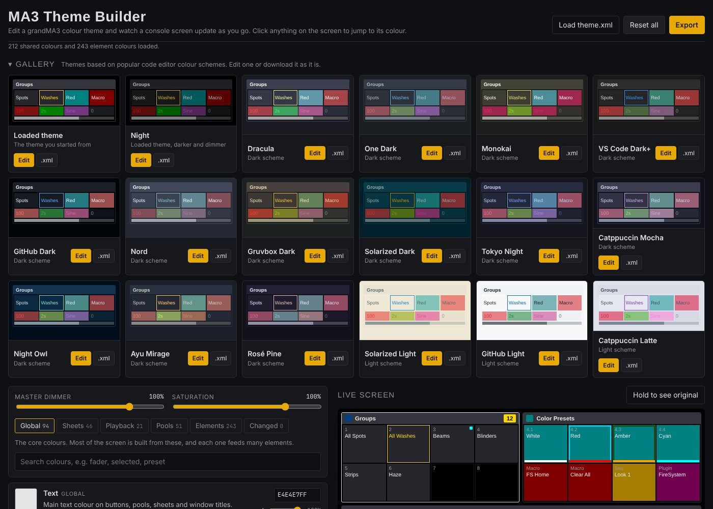

# MA3 Theme Builder



A browser tool for editing grandMA3 colour themes. Pick colours, read what each one does, and watch a mock console screen update as you go.

**Live:** https://themes.sulfurdesign.com/

## What it does

- Loads a grandMA3 `ColorTheme` XML (a dark theme exported from MA 2.5.1 is bundled as `theme.xml`).
- Lists every shared colour (Global, Sheets, Playback, Pools) with a colour picker, hex box, opacity slider and a short note on where it shows up, plus which screen elements use it.
- Lists the element colours that aren't linked to a shared colour, for fine control.
- A live screen with pools, a fixture sheet, executors, buttons and the command line. Click anything on it to jump to its colour.
- A separate gallery page (`gallery.html`) with community themes and built-in ones based on popular code editor colour schemes (Dracula, One Dark, Monokai, VS Code Dark+, GitHub, Nord, Gruvbox, Solarized, Tokyo Night, Catppuccin, Night Owl, Ayu, Rosé Pine) plus MA's Legacy and Daylight themes and a darker Night version of the bundled theme. Edit any of them or download it straight away.
- Master dimmer and saturation sliders, and a hold-to-compare button.
- Exports the theme with the original file's structure untouched, so it imports straight back into MA3. Exporting with no changes gives back the original file byte for byte.

Edits are kept in your browser between visits.

## Using a theme on the console

Save the exported `.xml` into `gma3_library/colorthemes` (on a USB stick for a console, or in the MA library folder on onPC), then import it from the Color Theme menu.

## Sharing themes to the gallery

**Share to gallery** (under Export) opens a prefilled "Submit a theme" issue on GitHub. The theme travels as a short code (`MA3T1-...`, about 2.4k characters) holding every colour of the bundled theme.

`.github/workflows/gallery.yml` checks each submission and replies with a preview link. When the repo owner adds the `approved` label, it adds the theme to `gallery/themes.json`, closes the issue and redeploys the site. Removing a theme is a normal edit to `gallery/themes.json`.

## Files

- `index.html`: editor layout and the live screen markup
- `gallery.html`, `gallery.js`: the gallery page
- `main.css`: styles for both pages
- `core.js`: theme parsing and export, gallery schemes and share codes, shared by both pages and the gallery workflow
- `main.js`: the editor
- `gallery/themes.json`: approved community themes
- `themes/`: MA's own Legacy and Daylight themes, shown in the gallery and downloaded as they are
- `scripts/gallery-submission.cjs`: checks and adds submissions (run by the gallery workflow)
- `theme.xml`: the bundled starting theme

## Running locally

```
python3 -m http.server
```

Then open http://localhost:8000. Opening `index.html` straight from disk won't load the bundled theme, because browsers block `fetch` from `file://`; use **Load theme.xml** instead.

## Deploying

`.github/workflows/pages.yml` publishes the site to GitHub Pages on every push to `main`. In the repo's Settings > Pages, set Source to **GitHub Actions** once.
